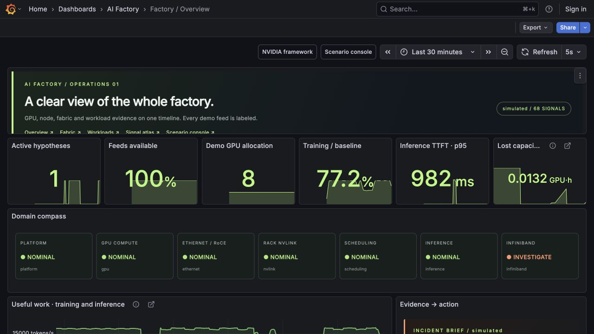
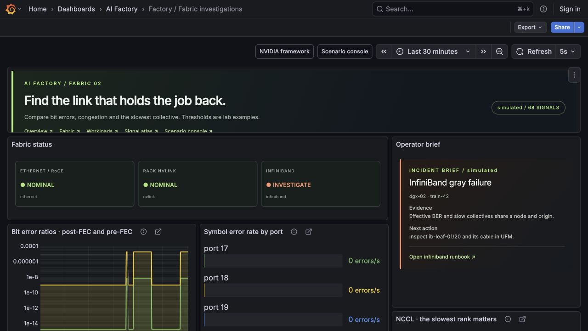
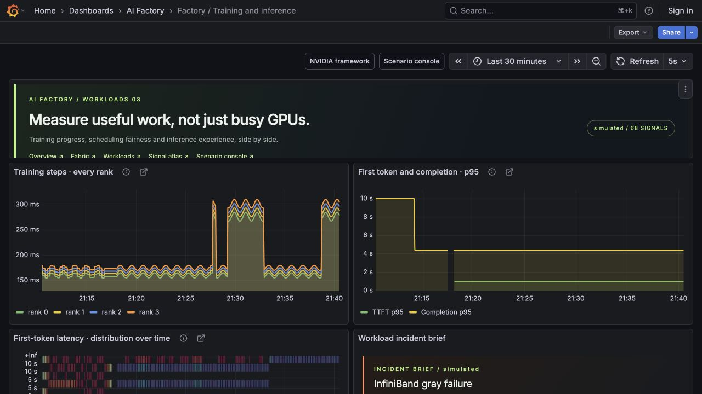
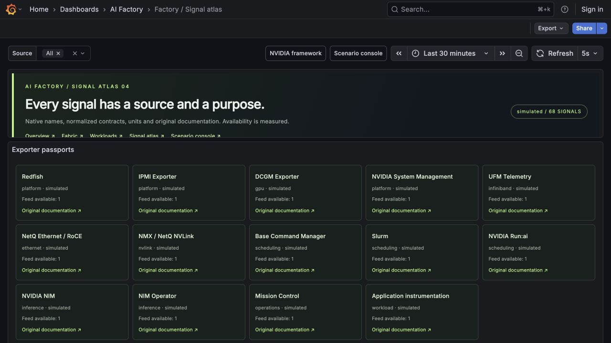
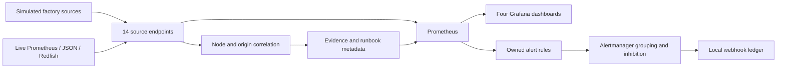

# AI Factory Observability Lab

**Find the component behind a slow AI workload, then connect the evidence to an owner and a runbook.**

A runnable laptop lab inspired by [NVIDIA's full-stack observability framework](https://developer.nvidia.com/blog/how-to-choose-full-stack-observability-for-nvidia-ai-factories/). It includes **14 telemetry source endpoints, 68 selected signals, four provisioned Grafana dashboards, 48 panels, 12 panel types, ten controlled scenarios, and an end-to-end alert delivery ledger**.

**Default hardware and workload telemetry is simulated.** Grafana, Prometheus and Alertmanager are real services. Native Prometheus, JSON and Redfish adapters can replace individual simulated feeds. Specialized NVIDIA products are not installed or licensed by this repository; their documented telemetry surfaces are modeled until you connect a real deployment.



## Start the complete stack

### Docker Compose

Requirements: Docker with Compose and internet access for version-pinned images and the signed Grafana panel plugin.

```bash
git clone https://github.com/sivalinb/ai-factory-observability-lab.git
cd ai-factory-observability-lab
cp .env.example .env
# Set your local Grafana admin password in .env.
docker compose up --build -d
```

The dashboards populate after two or three scrapes. Leave the lab running to accumulate history, or use native mode's labeled historical seed for an immediate demonstration.

### Native macOS / Linux, without Docker

Requirements: Python 3.9+, macOS/Linux arm64/amd64, internet access on first launch, and free localhost ports 3000, 8090, 9090 and 9093.

```bash
python3 scripts/native.py up --seed
```

This downloads official version-pinned runtimes into `.runtime/`, loads 45 minutes of explicitly simulated history, and starts the same services. `--seed` requires a fresh empty TSDB directory; omit it on subsequent starts. Admin credentials are generated once and stored in `.runtime/grafana-admin-password.txt`. Dashboard viewing uses localhost-only anonymous **Viewer** access. HTML sanitization and plugin signature verification remain enabled.

| Service | URL |
|---|---|
| Grafana overview | http://localhost:3000/d/factory-overview |
| Scenario console and notification ledger | http://localhost:8090 |
| Prometheus | http://localhost:9090 |
| Alertmanager | http://localhost:9093 |

```bash
python3 scripts/native.py status
python3 scripts/native.py down
# Or, for Compose:
docker compose down
```

## Take the guided incident tour

1. Open the **scenario console**, choose **InfiniBand gray failure**, and open **Factory / Overview**.
2. Watch the InfiniBand domain become **Investigate** while GPU utilization remains high.
3. Open **Factory / Fabric investigations**. Compare effective BER and symbol errors to per-rank collective duration.
4. Read the **Business Text incident brief**: evidence, affected node/workload, and runbook.
5. After the alert's hold and routing interval, inspect the console's **Alert delivery ledger**. This is a real Alertmanager webhook.
6. Choose **Telemetry gap**. The InfiniBand domain becomes **Unknown**, and the atlas marks its signals missing.
7. Return to **Healthy baseline**. Historical faults remain on the charts; current gauges recover immediately, while rate-based signals recover over their windows.

The other scenarios cover GPU XID/ECC, cooling/power, RoCE congestion, rack NVLink, scheduling starvation, inference overload and local storage degradation. Scenario controls affect simulated feeds only.

## Dashboard gallery

| Dashboard | Design and panels |
|---|---|
| **Factory / Overview** | Business Text hero and domain compass; KPI stats; useful-work timelines; topology node graph; collector bar gauges; GPU thermal gauge; domain state timeline; GPU activity deck; alert table; provenance donut |
| **Factory / Fabric investigations** | Business Text evidence brief; logarithmic BER chart; port error bar gauges; rank collective timing; node graph; InfiniBand/RoCE/NVLink throughput; PFC and buffer pressure; NVLink status history |
| **Factory / Training and inference** | Per-rank training steps; p95 inference latency; latency heatmap; KV-cache gauge; request queues; quota/allocation bar chart; scheduling waits; NIM Operator state table |
| **Factory / Signal atlas** | Business Text exporter passports; signal dictionary with clickable original documentation links; per-source signal coverage; collection age |

The requested [Business Text / Dynamic Text plugin](https://grafana.com/grafana/plugins/marcusolsson-dynamictext-panel/) is pinned to **6.3.0**, with Grafana **12.3.0**. Templates use queried Prometheus data and scoped CSS. They have empty JavaScript hooks and require no external frontend library.





## Source coverage and signal provenance

| Source | Demonstrated signals / role | Native path |
|---|---|---|
| Redfish | Fan, PSU, chassis temperature, BMC health | Implemented Redfish collector |
| IPMI Exporter | Fan, temperature and discrete sensor health | Existing IPMI exporter's Prometheus endpoint |
| DCGM Exporter | GPU/memory utilization, watts, temperature, XID, ECC, clocks, framebuffer, node NVLink, thermal limiting | Prometheus adapter |
| NVSM | DGX system, CPU, memory, PCIe and storage health | Prometheus or explicit JSON mappings |
| UFM | InfiniBand traffic, symbol errors, effective/raw BER, chip temperature and transmit waits | Prometheus/JSON mappings with validated units and aggregation |
| NetQ | RoCE PFC, ECN, drops, link flaps and buffers | Prometheus or explicit JSON mappings |
| NMX / NetQ NVLink | Rack links, traffic, errors and partitions | Prometheus adapter with installed-schema mappings |
| BCM | Jobs, reservations, waits, idle allocations and managed node health | Prometheus or explicit JSON mappings |
| Slurm | Running jobs and pending waits | Existing exporter or REST normalization |
| Run:ai | Allocations, quotas, pending jobs, waits and idle allocations | Prometheus or explicit JSON mappings |
| NIM | Request outcomes, token generation, queueing, KV cache and latency histograms | Prometheus adapter |
| NIM Operator | Cache/service/pipeline state and reconciliation errors | Prometheus adapter |
| Mission Control | A modeled recovery workflow indicator | Explicit integration extension; the lab indicator is not a vendor metric |
| Application | Steps, collectives, progress, baseline and lost capacity estimate | Optional measured PyTorch workload |

Every source is scraped separately. [The full signal atlas](docs/signals.md) gives the type, unit, original field, interpretation, query, action and original documentation link for each selected signal. [Machine-readable catalog](catalog/signals.json).

`lab_*` metrics are **project-defined normalization contracts**. They are not invented claims about vendor metric names. Version-specific exporter names are explicitly labeled. The article's `SPD_FAN_*`, `PWR_*` and `TEMP_*` patterns appear as BMC sensor labels. The UFM fields explicitly named in the article are mapped in the catalog, with conversion notes.

Scope means all telemetry sources and explicitly named article signals, plus a selected operational set for the remaining tools. It does **not** mean exporting every counter in every product's much larger catalog.

## Architecture and operational techniques



- **Coverage by failure domain:** platform, GPU, InfiniBand, Ethernet/RoCE, rack NVLink, scheduling and inference. Missing feeds become unknown.
- **Useful-work SLIs:** training throughput relative to a fixed baseline; inference TTFT and successful model generation rate; scheduling waits and idle allocations.
- **A focused alert set:** 12 owned alerts rather than every available counter. See [alert ownership and expressions](docs/alerts.md).
- **Two levels of investigation:** an overview followed by fabric/workload details, original docs and runbooks. Enterprise deployments can add their UFM, BCM Base View and NetQ deep links.
- **Gray-failure experiments:** preserve high GPU utilization while a single rank's communication performance degrades.
- **Explicit provenance:** original source, live/simulated mode, native versus normalized naming, and collection availability are visible.

Diagnostic rules join supporting measurements by **node and telemetry origin**, or by project for scheduling. They do not read the scenario name. Hypotheses are bounded examples, not a general causal inference engine. The graph is explicitly a demo inventory; native topology discovery and actual job placement require deployment-specific integration.

## Connect a real cloud GPU or enterprise feed

Follow [native integration instructions](docs/native-integrations.md). Copy the source example to ignored `config/sources.local.json`, edit only the feeds you can actually access, and start:

```bash
python3 scripts/native.py up --sources config/sources.local.json
```

Unspecified sources stay simulated and labeled. A failed live feed emits no simulated replacement. Native metric aliases, units, availability, fabric topology and upstream cadence must match the installed release.

Optional real workload tools:

```bash
# After installing the appropriate PyTorch build:
python3 workloads/train.py --device cuda --steps 2000
torchrun --standalone --nproc_per_node=2 workloads/train.py --slow-rank 1 --delay-ms 50
# Against your own compatible NIM deployment:
python3 workloads/nim_load.py --model YOUR_MODEL_ID --concurrency 4 --requests 30
```

The trainer uses actual PyTorch computation and an explicit NCCL collective on CUDA; Gloo is used on CPU. Its toy token model is a teaching workload. Hardware faults remain simulated. The NIM load generator uses a fixed public prompt and returns measured client latency/outcomes.

## Validate and extend

```bash
python3 scripts/build.py
python3 -m unittest discover -s tests -v
# With the stack running:
python3 scripts/verify.py --faults --output reports/verification.local.json
```

The unit suite checks coverage, counter monotonicity, histogram consistency, fault attribution, origin isolation, adapters and metadata. The integration verifier checks all scrape targets, provisioned dashboard queries, an actual fault-to-alert-to-webhook path, and missing-telemetry behavior. [Validation record](docs/validation.md).

Add a signal in `lab/catalog.py`, implement its simulation or measured adapter, rebuild artifacts, and attach an owner/action if it becomes an alert. `scripts/build.py` is the reproducible source for dashboard JSON, Prometheus rules, configs and generated signal documentation.

| Directory | Contents |
|---|---|
| `lab/` | Simulation, native adapters, evidence rules, endpoint server, console and runbooks |
| `catalog/` | Generated machine-readable signal definitions |
| `dashboards/` | Four importable Grafana JSON dashboards |
| `config/` | Prometheus, Alertmanager, Grafana provisioning and source examples |
| `scripts/` | Build, native startup, historical seed and integration verification |
| `workloads/` | Optional real training and streaming NIM load tools |
| `tests/` | Behavioral and data-contract checks |
| `docs/` | Signals, integration guide, alert ownership and validation |

MIT-licensed project code. Referenced vendor tools, Grafana, Prometheus and the plugin retain their respective licenses.
