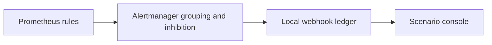

# Alerts and ownership

Thresholds are deliberately chosen for controlled lab scenarios. They are not NVIDIA production limits. All alerts carry an owner, action, dashboard and runbook URL.

| Alert | Domain | Owner | Hold | Action |
|---|---|---|---|---|
| `TelemetrySourceUnavailable` | telemetry | observability | 10s | Restore the unavailable source; domain health is unknown. |
| `GpuXidObserved` | gpu | gpu-platform | 10s | Classify the observed XID code and inspect the node. |
| `PlatformThermalFault` | platform | datacenter | 10s | Inspect cooling, power and clock limiting. |
| `StorageHealthFault` | platform | gpu-platform | 10s | Inspect local storage and input pipeline health. |
| `InfiniBandGrayFailure` | infiniband | fabric | 10s | Inspect the affected InfiniBand port and cable. |
| `RoceCongestion` | ethernet | fabric | 10s | Inspect RoCE buffers, PFC and ECN. |
| `NvlinkDomainDegraded` | nvlink | fabric | 10s | Inspect the NVLink domain and partition. |
| `SchedulingStarvation` | scheduling | ml-platform | 10s | Review quotas and idle reservations. |
| `InferenceCapacityPressure` | inference | serving | 10s | Inspect queue depth and concurrency limits. |
| `TrainingProgressSlow` | workload | training | 20s | Use the triage board to inspect progress and infrastructure. |
| `InferenceLatencySlo` | inference | serving | 20s | Investigate first-token latency with queue and fabric evidence. |
| `InferenceSuccessSlo` | inference | serving | 20s | Investigate failed model generations. |

Only the matching training symptom is inhibited by the InfiniBand cause alert, using cluster, origin and workload equality. Unrelated workloads retain their notifications.

